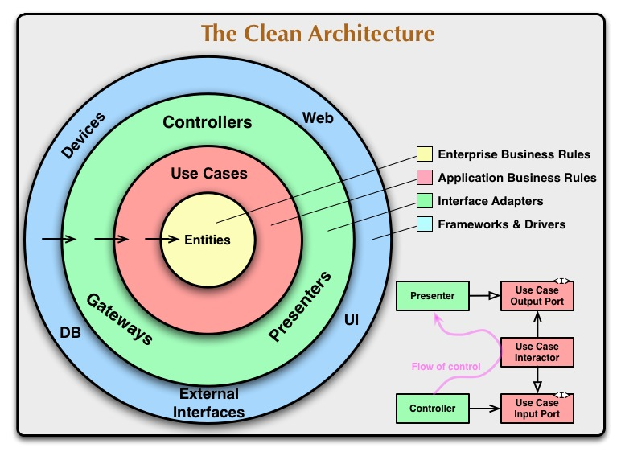
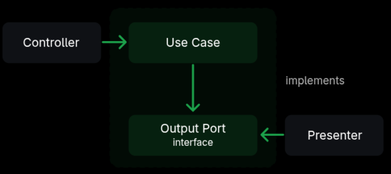
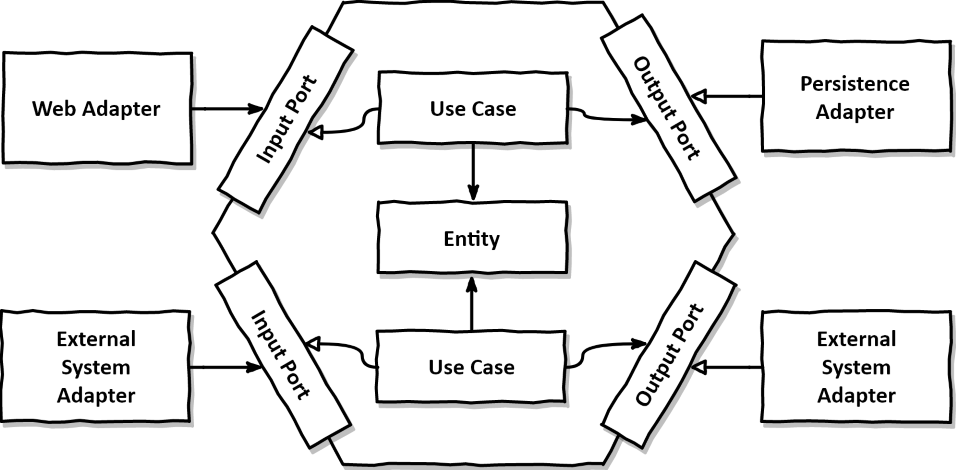

클린 아키텍처와 헥사고날 아키텍처는 모두 핵심 비즈니스 로직을 외부 기술로부터 보호하려는 설계입니다. 이번 글에서는 각 아키텍처의 원칙과 구성 요소를 살펴보고, 두 아키텍처가 강조하는 지점을 비교해 보겠습니다.

# 클린 아키텍처

소프트웨어의 관심사를 분리하고, 핵심 비즈니스 로직이 UI, 데이터베이스, 프레임워크와 같은 외부 기술에 종속되지 않도록 설계하는 소프트웨어 아키텍처입니다.

이를 통해 외부 기술이 변경되더라도 핵심 비즈니스 로직에 미치는 영향을 최소화하고, 애플리케이션을 외부 환경과 독립적으로 개발하고 테스트할 수 있도록 합니다.



## 의존성 규칙

위 동심원은 소프트웨어를 이루는 영역을 나타내며, 일반적으로 안쪽으로 갈수록 추상화 수준이 높아집니다. 추상화 수준이 높아진다는 말은 어떻게(How) 구현할 것인가? 보다 무엇(What)을 해야 하는가에 집중한다고 생각하면 됩니다.

따라서 원의 바깥으로 갈수록 소프트웨어의 구체적인 구현 방식인 메커니즘을, 안쪽으로 갈수록 소프트웨어가 수행해야 하는 규칙인 정책을 표현합니다.

그리고 이러한 영역을 분리하기 위해 의존성 규칙을 정의했으며, 이 규칙에 따라 소스 코드의 의존성은 오로지 안쪽을 향해야 합니다.

이는 곧 안쪽 원에 있는 코드는 바깥쪽 원의 구체적인 구현을 알지 못해야 하며, 바깥쪽 원에서 선언된 클래스, 함수, 변수 등의 이름이 안쪽 원의 코드에 등장해서도 안 된다는 것을 의미합니다.

또한 바깥쪽 원에서 사용하는 데이터 형식이 안쪽 원으로 전달되어 안쪽 코드가 외부 기술에 의존하는 상황도 방지해야 합니다.

예를 들어 데이터베이스 접근 기술로 JPA를 사용하더라도, 핵심 비즈니스 로직이 JPA의 구체적인 구현이나 데이터 형식에 직접 의존하지 않도록 구성하는 것입니다.

## 구성 요소

원문의 그림은 엔티티, 유스 케이스, 인터페이스 어댑터, 프레임워크와 드라이버의 네 영역을 보여줍니다. 영역의 수를 반드시 네 개로 고정해야 하는 것은 아니며, 중요한 것은 소스 코드의 의존성이 안쪽을 향한다는 규칙입니다.

### 엔티티 (Entity)

> 여기서 말하는 엔티티는 JPA의 `@Entity`와 같은 영속성 매핑 객체를 뜻하지 않습니다.

특정 화면이나 실행 절차에 종속되지 않는 핵심 비즈니스 규칙을 캡슐화합니다. 메서드를 가진 객체일 수도 있고, 데이터 구조와 함수의 조합일 수도 있습니다. 여러 애플리케이션에서 공유할 수 있는 일반적인 업무 규칙이라는 점이 중요하며, 단순히 재사용할 수 있다는 이유만으로 모든 코드를 엔티티라고 부르지는 않습니다.

외부 기술의 변화에 영향을 적게 받는 영역입니다. 화면 탐색 방식이나 인증 기술의 변경보다, 핵심 비즈니스 규칙 자체의 변경에 따라 수정됩니다.

### 유스 케이스 (Use Case)

애플리케이션의 특정 목표를 달성하기 위한 비즈니스 규칙과 실행 흐름을 구현하는 계층입니다. 엔티티가 일반적인 핵심 업무 규칙을 담는다면, 유스 케이스는 그 규칙을 활용하도록 엔티티와 데이터의 흐름을 조율합니다.

UI, DB, 프레임워크 등의 외부 구현 세부사항의 변경에는 영향을 받지 않아야 하지만, 애플리케이션이 수행해야 하는 업무 흐름이나 애플리케이션 정책이 변경되면 그에 따라 변경될 수 있습니다.

### 인터페이스 어댑터 (Interface Adapter)

유스 케이스와 엔티티가 사용하는 데이터 형식과, 데이터베이스나 웹 같은 외부 시스템의 데이터 형식을 변환하는 책임을 가집니다.

스프링 부트 애플리케이션에서는 컨트롤러와 영속성 어댑터 구현체를 예로 들 수 있습니다. 컨트롤러는 HTTP 요청을 유스 케이스가 받는 입력으로 변환하고, 영속성 어댑터는 내부의 저장 요청을 JPA 등 외부 기술에 맞게 처리합니다.

여기서 저장소 인터페이스와 구현체는 구분해야 합니다. 유스 케이스가 요구하는 저장소 인터페이스는 내부에 정의하고, 외부의 영속성 어댑터가 이를 구현하도록 구성할 수 있습니다.

### 프레임워크와 드라이버 (Frameworks and Drivers)

데이터베이스와 웹 프레임워크 같은 도구가 위치하는 가장 바깥 영역입니다. 안쪽의 어댑터는 이 도구들과 애플리케이션 사이를 연결합니다. 애플리케이션은 DB나 웹 프레임워크를 몰라도 독립적으로 실행 및 테스트할 수 있어야 합니다.

## 경계 넘나들기

`Controller`에서 시작하여 `Use Case`를 거친 다음, 최종적으로 `Presenter`를 실행하는 제어 흐름을 생각해 보겠습니다. `Controller`와 `Presenter`는 바깥쪽 같은 영역의 원에, `Use Case`는 안쪽 영역에 있다고 가정합니다.


```text
Controller → Use Case → Presenter
```

이때 `Use Case`에서 `Presenter`로 제어 흐름이 이동하므로, 소스 코드의 의존성이 바깥을 향한다고 생각할 수 있습니다.

하지만 제어 흐름과 소스 코드의 의존성 방향은 반드시 일치할 필요가 없습니다. 클린 아키텍처에서는 이러한 상황에서도 의존성 규칙을 유지하기 위해 의존성 역전 원칙(DIP)을 활용합니다.

예를 들어 `Use Case`가 같은 영역에 정의된 인터페이스(`Use Case Output Port`)를 호출하도록 하고, 바깥쪽 원에 있는 `Presenter`가 해당 인터페이스를 구현하도록 하는 것입니다.

그러면 `Use Case`는 `Presenter`의 구체적인 구현을 알 필요 없이 내부에 선언된 인터페이스를 호출할 수 있습니다. 반대로 `Presenter`는 해당 인터페이스를 구현해야 하므로 안쪽 원에 선언된 규약에 의존하게 됩니다.



즉, 실행 시에는 `Use Case`에서 `Presenter`로 제어 흐름이 이동하지만, 소스 코드의 의존성은 `Presenter`에서 안쪽 영역에 선언된 인터페이스를 향하게 됩니다.

정리하자면 클린 아키텍처는 DIP를 적극적으로 사용해, 경계를 넘나들며 영역간 통신을 처리하는 구조로 각 영역 간 일방적인 의존성을 유지합니다.

# 헥사고날 아키텍처

사용자 호출, 다른 프로그램, 배치 스크립트, 자동화된 테스트 등 다양한 실행 방식으로 애플리케이션을 동등하게 구동할 수 있도록 하고, 최종적인 실행 환경 및 인프라 요소와 독립적으로 애플리케이션을 개발하고 테스트할 수 있게 하는 소프트웨어 아키텍처 패턴입니다.



이 아키텍처는 포트와 어댑터(Port and Adapter) 아키텍처라고도 합니다.

외부에서 이벤트가 발생하면, 해당 기술에 맞는 어댑터가 이를 애플리케이션이 이해할 수 있는 프로시저 호출이나 메시지로 변환하여 포트를 통해 전달합니다.

이때 애플리케이션은 입력 장치의 구체적인 구현을 알 필요가 없습니다.

반대로 애플리케이션이 외부로 메시지를 보낼 때는 포트에 메시지를 전달하고, 어댑터가 외부 시스템에 적합한 전달 방식을 구현하여 메시지를 전송합니다.

## 설계 의도

Cockburn은 비즈니스 로직이 사용자 인터페이스 코드에 섞이는 문제를 주요 동기로 제시합니다. 데이터베이스 등 외부 서비스에 로직이 결합되는 문제도 같은 관점에서 다룹니다.

이로 인해 다음 문제가 발생합니다.

- 테스트해야 할 로직의 일부가 자주 변경되는 시각적 요소에 의존하여 자동화된 테스트를 활용하기 어렵습니다.
- 실행 방법(CLI 상호작용, REST API, 배치 프로그램 등)을 유연하게 변경하기 어렵습니다.
- 다른 프로그램에서 애플리케이션의 기능을 재사용하기 어렵습니다.

이를 해결하기 위해 애플리케이션에 새로운 계층을 도입하고 비즈니스 로직을 분리하더라도, 계층 간 책임이 올바르게 유지되는지 검증할 수 없다면 동일한 문제가 반복될 수 있습니다.

따라서 비즈니스 로직을 사용자 인터페이스로부터 분리하는 것뿐만 아니라, 이러한 분리가 지속적으로 유지되는지 검증할 수 있는 구조가 필요합니다. 예를 들어 애플리케이션이 제공하는 모든 기능을 사용자 인터페이스와 독립적인 API나 함수 호출을 통해 사용할 수 있도록 설계할 수 있습니다.

이러한 구조에서는 사용자 인터페이스를 실행하지 않고도 애플리케이션의 기능을 직접 호출하여 회귀 테스트를 수행할 수 있습니다. UI에만 구현된 업무 규칙 때문에 같은 기능을 수행하지 못한다면, 로직이 외부로 새어 나간 상황을 발견하는 단서가 됩니다.

### 위아래 계층 구조로만 바라볼 때 놓치기 쉬운 점

원문은 사용자와 데이터베이스를 위아래에 둔 계층 그림이 유도하는 인식의 한계를 지적합니다. 두 요소는 역할이 다르지만, 모두 애플리케이션 외부에 있으며 포트를 통해 연결된다는 공통점이 있습니다.

컨트롤러-서비스-레포지토리라는 구분만으로는 경계가 지켜지지 않습니다. 예를 들어 컨트롤러에 비즈니스 로직을 작성해도 컴파일이나 실행에는 문제가 없을 수 있습니다. 또한 결제 API, 메시지 브로커 등 여러 외부 시스템과의 관계를 하나의 위아래 흐름으로만 그리면 각각의 통신 목적과 경계를 놓치기 쉽습니다.

이는 계층형 아키텍처가 여러 외부 시스템을 지원할 수 없다는 뜻은 아닙니다. 헥사고날 아키텍처는 내부와 외부의 구분, 그리고 목적별 포트와 어댑터를 통해 이러한 관계를 명시적으로 드러냅니다.

다만 헥사고날 구조도 경계를 자동으로 강제하지는 않습니다. 패키지와 모듈의 의존성 제한, 아키텍처 검사, 기능 테스트 등을 통해 설계 의도가 유지되는지 확인해야 합니다.

## 포트와 어댑터

- 포트: 애플리케이션과 외부 사용자 또는 다른 시스템 사이의 통신 규약을 정의하는 API

외부 시스템의 구체적인 구현 방식보다 애플리케이션과 외부 시스템 사이에서 어떤 목적의 통신이 이루어져야 하는지에 집중합니다.

- 어댑터: 외부 세계와 애플리케이션 사이에서 각 기술에 맞는 상호작용을 포트의 API에 매핑

어댑터의 적절한 예시로 GUI가 존재합니다. GUI는 사용자의 움직임을 포트의 API에 매핑하여 애플리케이션을 동작시킵니다. GUI를 CLI로 교체하는 것만으로 포트의 API가 바뀌어서는 안 됩니다. 포트는 입력 기술보다 애플리케이션이 제공하는 기능을 기준으로 정의합니다. 다만 업무 요구나 통신 목적이 달라진다면 포트의 API도 변경될 수 있습니다.

이러한 구조를 통해 하나의 포트에 서로 다른 기술을 사용하는 여러 어댑터를 연결할 수 있으며, 애플리케이션은 외부 기술의 구체적인 구현에 직접 의존하지 않고 기능을 수행할 수 있습니다.

### 적용 예시

예를 들어 주문 취소 기능을 개발한다고 가정해 보겠습니다.

애플리케이션을 구동하는 입력 포트와, 애플리케이션이 외부 기능을 요청하는 출력 포트로 나누어 생각할 수 있습니다. 여기서 입력과 출력은 HTTP 응답처럼 데이터가 오가는 방향보다 누가 상호작용을 시작하는지를 기준으로 구분합니다.

- 입력 포트: 주문 취소 기능을 제공하는 규약. HTTP 컨트롤러나 자동화된 테스트가 이 포트를 통해 같은 유스 케이스를 실행합니다.
- 출력 포트: 유스 케이스가 필요로 하는 주문 조회·저장 규약. JPA 기반 영속성 어댑터나 테스트용 메모리 어댑터가 이를 구현합니다.

예를 들어 Java 인터페이스로 포트를 정의한다면 소스 코드 의존성은 다음처럼 표현할 수 있습니다. 출력 포트는 취소 결과를 화면에 표시하는 포트와 달리, 저장소 접근을 위한 포트입니다.


```text
HTTP 컨트롤러 → 주문 취소 입력 포트 ← 주문 취소 유스 케이스
주문 취소 유스 케이스 → 주문 저장소 출력 포트 ← JPA 영속성 어댑터
주문 취소 유스 케이스 → 주문 엔티티
```

실행 시 유스 케이스는 출력 포트를 통해 영속성 어댑터의 동작을 호출하지만, 소스 코드에서는 내부에 정의된 규약에 의존합니다. 따라서 웹 서버와 실제 DB 없이도 테스트용 어댑터를 연결해 취소 흐름과 업무 규칙을 검증할 수 있습니다.

# 클린 아키텍처와 헥사고날 아키텍처 비교

두 아키텍처는 모두 애플리케이션의 핵심 로직을 외부 기술로부터 분리하여 독립적으로 개발하고 테스트할 수 있도록 하는 것을 목표로 합니다.

클린 아키텍처는 소프트웨어의 관심사를 여러 영역으로 분리하고, 소스 코드의 의존성이 안쪽을 향하도록 하는 규칙을 강조합니다. 그리고 헥사고날 아키텍처는 애플리케이션의 내부와 외부를 구분하고, 포트와 어댑터를 통해 다양한 외부 시스템과 통신할 수 있도록 설계하는 것을 강조합니다.

두 아키텍처 모두 DIP를 활용하여 애플리케이션 내부가 외부 기술의 구체적인 구현에 직접 의존하지 않도록 구성할 수 있습니다. 따라서 클린 아키텍처의 의존성 규칙을 준수하면서 헥사고날 아키텍처의 포트와 어댑터를 활용하는 방식으로 두 아키텍처의 설계 원칙을 함께 적용할 수 있습니다.

---

두 아키텍처가 강조하는 지점을 각각 요약하면 다음과 같습니다.

- **Hexagonal Architecture:** Port/Adapter를 통해 애플리케이션 코어를 외부 세계의 기술적 세부사항으로부터 격리합니다.

- **Clean Architecture:** 외부 세부사항으로부터 핵심 정책을 보호하면서, 전체 계층의 소스 코드 의존성이 `Adapter → Use Case → Entity`처럼 더 안쪽의 정책을 향하도록 통제합니다. 필요하면 DIP를 이용해 의존성 방향을 뒤집습니다.

사실 클린 아키텍처는 헥사고날을 포함한 여러 설계 아이디어를 통합한 모델이므로, 두 구조는 상당 부분 겹칩니다.

헥사고날은 내부와 외부의 상호작용 경계를, 클린은 내부까지 포함한 정책 수준과 의존성 방향을 강조합니다. 또한 두 아키텍처 모두 계층 개수를 고정하지 않으므로 계층 구성만으로 둘을 구분하기도 어렵습니다.

# 참고 자료

[**The Clean Architecture**](https://blog.cleancoder.com/uncle-bob/2012/08/13/the-clean-architecture.html)

[**The Hexagonal (Ports & Adapters) Architecture**](https://alistair.cockburn.us/hexagonal-architecture)
